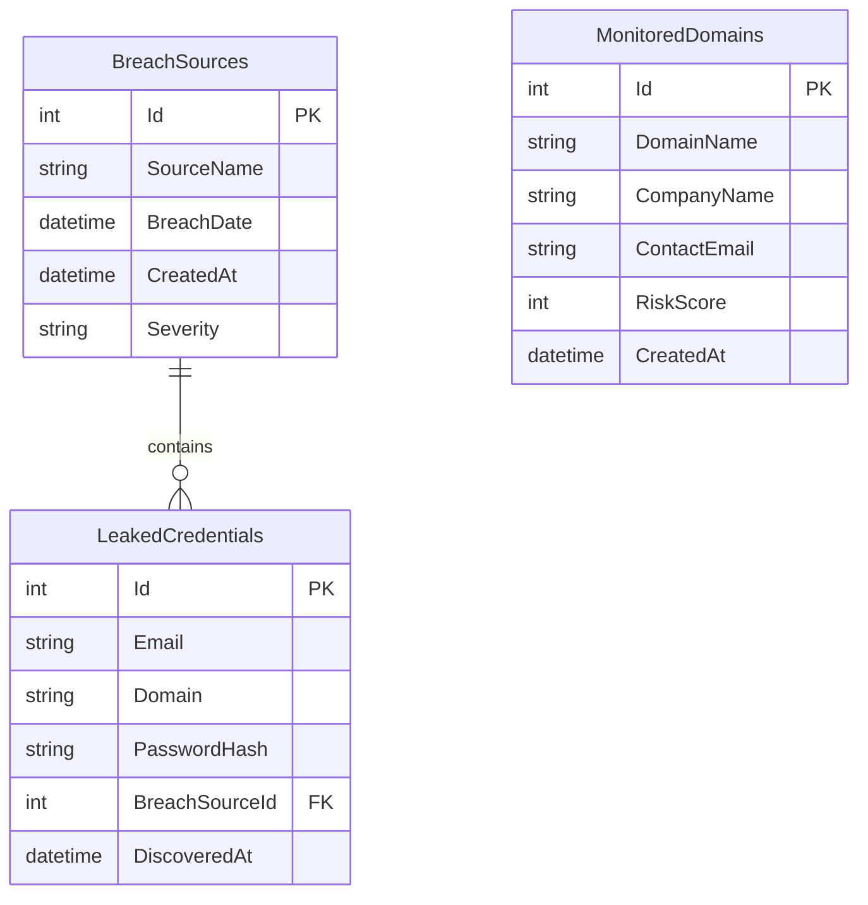

# IntelSphere API

> Threat Intelligence & Data Breach Monitoring REST API built with .NET 8 and Entity Framework Core.

[](https://github.com/HasretIrmak/intelsphere-api/actions/workflows/dotnet.yml)
[](https://dotnet.microsoft.com/)
[](https://learn.microsoft.com/ef/core/)
[](https://www.sqlite.org/)
[](https://swagger.io/)
[](LICENSE)

IntelSphere is a RESTful backend for tracking company domains, recording data breach sources, and scoring each domain's exposure based on the leaked credentials found against it. It is built with ASP.NET Core on .NET 8 using a layered structure (controllers, validated DTOs, and an EF Core data layer) and ships with interactive Swagger / OpenAPI documentation.

## Highlights

- **Complete CRUD** for breach sources and monitored domains, with versioned routes (`/api/v1/...`).
- **Risk analysis engine** that turns leaked credential counts into a risk score and a status label per domain.
- **Dashboard endpoint** with aggregated counters, the average risk score, the top three riskiest companies, and an overall threat level.
- **Input validation** on request DTOs: invalid payloads return `400 Bad Request` before reaching business logic.
- **Referential integrity:** deleting a breach source also deletes the leaked credentials recorded against it.
- **Automated tests and CI:** integration tests run against an isolated in-memory database on every push and pull request.

## API Overview

Interactive documentation is available in Swagger UI once the application is running.

### Breach sources

| Method | Route | Description |
| :--- | :--- | :--- |
| `GET` | `/api/v1/BreachSources` | List all breach sources |
| `GET` | `/api/v1/BreachSources/{id}` | Get a breach source by id |
| `POST` | `/api/v1/BreachSources` | Create a breach source (`201 Created`) |
| `PUT` | `/api/v1/BreachSources/{id}` | Update a breach source (`204 No Content`) |
| `DELETE` | `/api/v1/BreachSources/{id}` | Delete a breach source and its leaked credentials |

### Monitored domains

| Method | Route | Description |
| :--- | :--- | :--- |
| `GET` | `/api/v1/MonitoredDomains` | List all monitored domains |
| `GET` | `/api/v1/MonitoredDomains/{id}` | Get a monitored domain by id |
| `POST` | `/api/v1/MonitoredDomains` | Start monitoring a domain (normalized to lowercase, initial risk score `0`) |
| `PUT` | `/api/v1/MonitoredDomains/{id}` | Update a monitored domain |
| `DELETE` | `/api/v1/MonitoredDomains/{id}` | Stop monitoring a domain |
| `POST` | `/api/v1/MonitoredDomains/simulate-leaks` | Load synthetic leaked credentials (replaces any existing ones) |
| `POST` | `/api/v1/MonitoredDomains/analyze/{domainName}` | Calculate and store the risk score for a domain |

### Dashboard

| Method | Route | Description |
| :--- | :--- | :--- |
| `GET` | `/api/v1/Dashboard/overview` | Counters, average risk score, top three riskiest companies, overall threat level |

Unknown ids return `404 Not Found` with a JSON message.

## Try It

Start the API (see [Getting Started](#getting-started)), then run the following in a terminal:

```bash
# 1. Start monitoring a domain
curl -X POST http://localhost:5090/api/v1/MonitoredDomains \
  -H "Content-Type: application/json" \
  -d '{"domainName":"example.edu","companyName":"Example University","contactEmail":"security@example.edu"}'

# 2. Load synthetic sample leaks
curl -X POST http://localhost:5090/api/v1/MonitoredDomains/simulate-leaks

# 3. Analyze the domain
curl -X POST http://localhost:5090/api/v1/MonitoredDomains/analyze/example.edu

# 4. View the dashboard
curl http://localhost:5090/api/v1/Dashboard/overview
```

The analysis response looks like this:

```json
{
  "message": "Cyber risk analysis completed for 'example.edu'.",
  "totalLeakCount": 3,
  "calculatedCyberRiskScore": 75,
  "status": "CRITICAL DANGER"
}
```

## Risk Scoring

Each leaked credential recorded for a domain adds 25 points, capped at 100.

| Leaked credentials | Risk score | Status |
| :--- | :--- | :--- |
| 0 | 0 | `SECURE` |
| 1 | 25 | `MEDIUM DANGER` |
| 2 | 50 | `HIGH RISK` |
| 3 | 75 | `CRITICAL DANGER` |
| 4 or more | 100 | `CRITICAL DANGER` |

The dashboard derives the overall threat level from the average risk score of all monitored domains: 75 or more is `CRITICAL CONDITION (RED ALERT)`, 50 or more is `HIGH THREAT (ORANGE ALERT)`, an average of 0 with no leaked credentials is `LOW LEVEL / SECURE`, and anything else is `MEDIUM LEVEL CYBER ACTIVITY`.

## Data Model



`LeakedCredentials` rows belong to a `BreachSource` (cascade delete). A monitored domain is matched to leaked credentials by its domain name, which is indexed on `LeakedCredentials.Domain`.

## Tech Stack

| Layer | Technology |
| :--- | :--- |
| Language / Runtime | C#, .NET 8 |
| Web framework | ASP.NET Core Web API |
| Data access | Entity Framework Core (code-first migrations) |
| Database | SQLite |
| API documentation | Swagger / OpenAPI |
| Testing | xUnit, `WebApplicationFactory`, in-memory SQLite |
| CI | GitHub Actions |

## Repository Layout

```text
intelsphere-api/
├── .github/workflows/dotnet.yml   # CI: build and test on every push and pull request
├── IntelSphere.API/               # ASP.NET Core Web API
│   ├── Controllers/
│   ├── Data/
│   ├── DTOs/
│   ├── Migrations/
│   ├── Models/
│   └── Program.cs
├── IntelSphere.API.Tests/         # xUnit integration and data model tests
├── IntelSphere.API.sln
├── LICENSE
└── README.md
```

## Getting Started

### Prerequisites

- [.NET 8 SDK](https://dotnet.microsoft.com/download/dotnet/8.0)
- EF Core CLI tools:

  ```bash
  dotnet tool install --global dotnet-ef
  ```

### Run Locally

```bash
# 1. Clone the repository
git clone https://github.com/HasretIrmak/intelsphere-api.git
cd intelsphere-api

# 2. Restore dependencies
dotnet restore

# 3. Create the local SQLite database
dotnet ef database update --project IntelSphere.API

# 4. Start the API
dotnet run --project IntelSphere.API
```

The API listens on `http://localhost:5090` (configured in `IntelSphere.API/Properties/launchSettings.json`). In the `Development` environment the root URL redirects to Swagger UI at `http://localhost:5090/swagger`.

## Testing

```bash
dotnet test
```

- **API integration tests** boot the application in memory with `WebApplicationFactory` and call every controller over HTTP. Each test runs against its own isolated in-memory SQLite database, so tests never touch `IntelSphere.db` and never affect each other.
- **Data model tests** verify persistence and cascade-delete behavior directly against EF Core.
- **Hardening tests** cover request validation, culture-safe domain normalization, and the leak simulation.

The same suite runs automatically on every push and pull request through GitHub Actions.

## Configuration

The database connection is read from the `DefaultConnection` entry in `IntelSphere.API/appsettings.json`. By default it points to a local SQLite file named `IntelSphere.db`, which is created by the migration step and excluded from version control.

## Sample Data

This project is intended for educational and portfolio purposes. The `simulate-leaks` endpoint loads synthetic records only: reserved `example.com` and `example.edu` domains with placeholder hashes. The project does not collect or ship real leaked credentials.

## Roadmap

- [ ] PostgreSQL support for deployment
- [ ] Pagination and filtering for list endpoints
- [ ] Authentication and authorization
- [ ] Docker and Docker Compose support
- [ ] Code coverage reporting in CI

## License

This project is licensed under the MIT License. See the [LICENSE](LICENSE) file for details.
